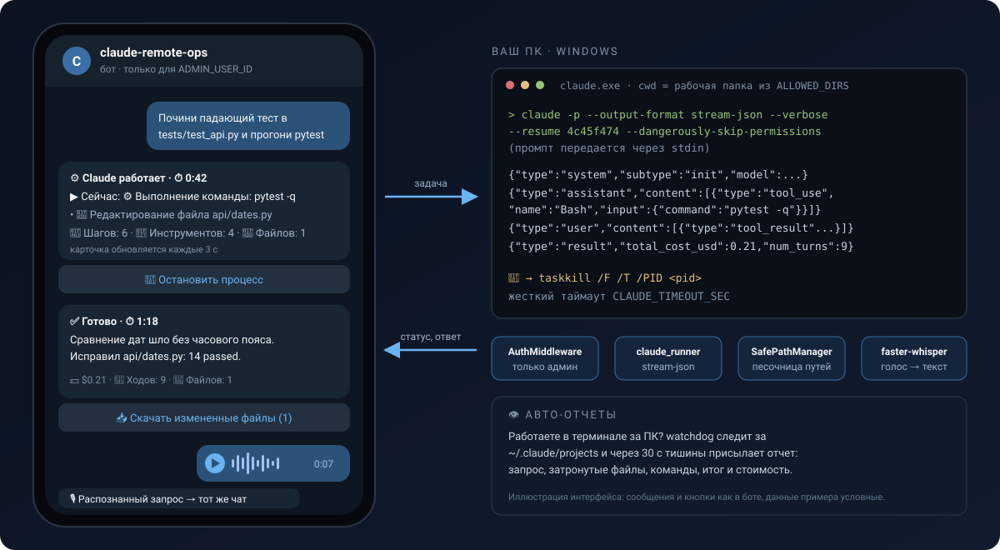
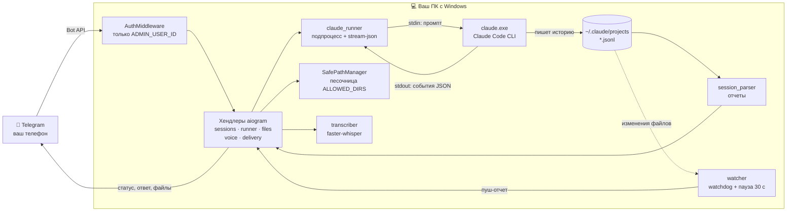
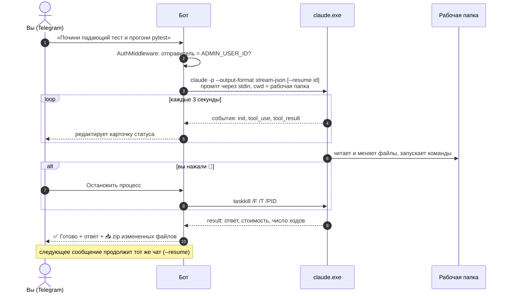
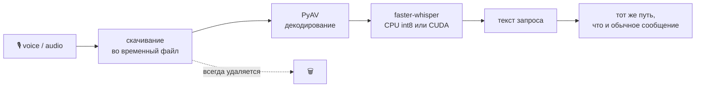
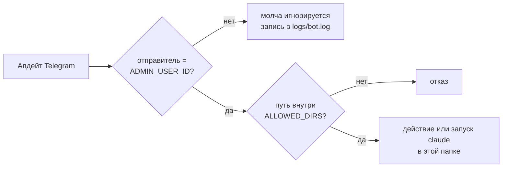

<div align="center">

# claude-remote-ops

**Пульт для Claude Code в Telegram: ставьте задачи агенту на своем ПК с телефона, следите за ходом работы и забирайте результат.**

[](https://github.com/EGRNEGR/claude-remote-ops/actions/workflows/tests.yml)


[](LICENSE)



</div>

## Зачем

Claude Code работает в терминале на вашем компьютере. Стоит отойти от него, и вы теряете контроль: не видно, чем закончилась долгая сборка, нельзя поправить задачу или остановить зависший процесс. **claude-remote-ops** превращает Telegram в пульт: бот запускает `claude` на ПК, показывает каждый шаг агента, присылает ответ и измененные файлы и пишет, когда закончилась сессия, которую вы вели за компьютером.

## Возможности

| | Что умеет |
|---|---|
| 🚀 **Запуск задач** | Текст сообщения уходит в `claude -p`: продолжение текущего чата (`--resume`), новый чат или `--continue` в рабочей папке |
| 📡 **Живой статус** | Карточка обновляется каждые 3 с: текущее действие, последние шаги, число инструментов и файлов |
| 🛑 **Kill switch** | Кнопка останавливает все дерево процессов (`taskkill /F /T`), плюс жесткий таймаут на запуск |
| 📂 **Отчеты по сессиям** | Браузер проектов и сессий из `~/.claude/projects`: запрос, файлы, команды, итог, стоимость, полный отчет `.md` |
| 👁 **Авто-отчеты** | Поработали в терминале за ПК? Через 30 с тишины бот пришлет сводку по сессии |
| 🎙 **Голосовые задачи** | Голосовое или аудио распознается локально (faster-whisper) и выполняется как обычный текст |
| 🗂 **Файловый менеджер** | Проводник, поиск, предпросмотр, скачивание и загрузка файлов внутри разрешенных папок |
| 📥 **Результаты** | Длинный ответ приходит частями или файлом `response.md`, измененные файлы одним zip |
| 🔐 **Безопасность** | Только один владелец (`ADMIN_USER_ID`), песочница путей, промпт через stdin, режимы доступа и лимиты бюджета |

## Как это работает



### Одна задача от сообщения до ответа



### Голосовое сообщение



Встроенный в PyAV FFmpeg декодирует аудио, отдельный системный ffmpeg не нужен. Модель загружается при первом голосовом, распознавание идет в отдельном потоке и не блокирует бота.

## Быстрый старт

### Что понадобится

- Windows 10 или 11, PowerShell.
- Python 3.12 или новее.
- Установленный и авторизованный [Claude Code](https://docs.anthropic.com/en/docs/claude-code): команда `claude` работает в терминале.
- Telegram-бот: создайте его у [@BotFather](https://t.me/BotFather) и сохраните токен.

### Установка

```powershell
git clone https://github.com/EGRNEGR/claude-remote-ops.git
cd claude-remote-ops
powershell -ExecutionPolicy Bypass -File .\start_bot.ps1
```

Первый запуск создаст `.venv`, установит зависимости, скопирует `.env.example` в `.env` и откроет его в Блокноте. Заполните три обязательных параметра и запустите скрипт снова:

| Параметр | Где взять |
|---|---|
| `BOT_TOKEN` | [@BotFather](https://t.me/BotFather) → `/newbot` → токен вида `123456789:AA...` |
| `ADMIN_USER_ID` | Ваш числовой Telegram ID: напишите [@userinfobot](https://t.me/userinfobot) |
| `ALLOWED_DIRS` | Папки, к которым у бота есть доступ, через `;`, например `C:\Projects;D:\work` |

Напишите боту `/start`. После каждого запуска он присылает «🟢 claude-remote-ops запущен». Ключи `start_bot.ps1`: `-Reinstall` переустанавливает зависимости, `-NoRestart` отключает автоперезапуск после падения.

<details>
<summary>Ручная установка без скрипта</summary>

```powershell
py -3.12 -m venv .venv
.venv\Scripts\python.exe -m pip install -r requirements.txt
copy .env.example .env   # затем заполните BOT_TOKEN, ADMIN_USER_ID, ALLOWED_DIRS
.venv\Scripts\python.exe main.py
```

</details>

## Как пользоваться

1. **📂 Сессии** → проект → сессия: краткий отчет (запрос, затронутые файлы, команды, итоговый ответ, шаги, стоимость), полный отчет `.md` и скачивание затронутых файлов.
2. Выберите, где работать: **▶️ Продолжить этот чат** (`--resume`), **🎯 Сделать рабочей папкой** (новый чат) или **📌** в проводнике.
3. Напишите задачу обычным текстом или голосом. Бот запустит `claude` и будет показывать живой статус: `⚙️ Выполнение команды`, `📝 Редактирование файла`, `🔎 Поиск в коде` и так далее.
4. Ответ придет сообщением, длинный ответ частями или файлом `response.md`. Кнопка **📥 Скачать измененные файлы** отдает zip. Следующее сообщение продолжит тот же чат, `/new` начинает новый.
5. Если запуск уперся в отказ разрешений или в лимит ходов и бюджета, под ответом появится **🔓 Повторить без ограничений**: та же сессия продолжится без ограничений.

Документ или фото, отправленные боту, сохраняются в рабочую папку. Подпись к файлу можно сразу выполнить как задачу.

### Команды

| Команда | Что делает |
|---|---|
| `/start` | Главное меню |
| `/sessions` | Проекты и сессии Claude Code |
| `/files` | Файловый менеджер |
| `/get <имя или *.маска>` | Найти и скачать файл |
| `/mode` | Режим запуска, доступ и лимиты |
| `/new [задача]` | Новый чат в рабочей папке |
| `/continue [задача]` | Продолжить последний чат папки |
| `/status` | Состояние бота, запущенные процессы, устройство Whisper |
| `/watch` | Включить или выключить авто-отчеты |
| `/cancel` | Отменить ожидание ввода |
| `/help` | Справка |

### Доступ и лимиты: `/mode`

| Кнопка | Что передается в `claude.exe` |
|---|---|
| 🔓 Skip Permissions | `--dangerously-skip-permissions`, без `--allowedTools` (по умолчанию) |
| 🔒 Restricted Tools | `--allowedTools` из `CLAUDE_ALLOWED_TOOLS`, где `mcp__*` раскрывается в `mcp__<сервер>` |
| ♾ Auto | лимиты `CLAUDE_MAX_TURNS` и `CLAUDE_MAX_BUDGET_USD` из `.env`, `0` = без лимита |
| 💵 Эконом | `--max-turns 15 --max-budget-usd 2` |
| 🚀 Pro | `--max-turns 80 --max-budget-usd 15` |

> [!NOTE]
> Claude Code 2.1.304 не понимает шаблон `mcp__*` в `--allowedTools`, зато правило уровня сервера (`mcp__playwright`) разрешает все его инструменты. Бот сам собирает имена MCP-серверов из `~/.claude.json`, `.mcp.json` проекта и прошлых запусков, поэтому новые серверы подхватываются без правки `.env`.

## Настройка

Все параметры с комментариями описаны в [`.env.example`](.env.example). Самые нужные:

| Параметр | По умолчанию | Назначение |
|---|---|---|
| `CLAUDE_BINARY` | `claude` | имя или полный путь к CLI (`claude.exe`, `claude.cmd`, `claude.ps1`) |
| `SKIP_PERMISSIONS_DEFAULT` | `true` | режим полного доверия при первом запуске |
| `CLAUDE_TIMEOUT_SEC` | `3600` | жесткий лимит времени одного запуска |
| `MAX_CONCURRENT_RUNS` | `2` | сколько задач может идти одновременно |
| `CLAUDE_MODEL` | пусто | модель, пусто = модель из настроек Claude Code |
| `WATCH_ON_START` / `WATCH_DEBOUNCE_SEC` | `true` / `30` | авто-отчеты и пауза перед отчетом |
| `VOICE_ENABLED` | `true` | распознавание голосовых |
| `WHISPER_MODEL` | `medium` | `tiny` … `large-v3`, `turbo`; скачивается при первом голосовом |
| `WHISPER_DEVICE` | `auto` | CUDA, если загружаются cuBLAS 12 и cuDNN 9, иначе CPU `int8` |
| `VOICE_AUTO_RUN` | `true` | `false` = сначала показать распознанный текст с кнопками ▶️ / ❌ |

<details>
<summary>Включить распознавание на GPU</summary>

Одного драйвера NVIDIA мало: ctranslate2 нужны DLL cuBLAS 12 и cuDNN 9. Без них процесс падает целиком, поэтому режим `auto` заранее проверяет загрузку DLL и иначе работает на CPU.

```powershell
.venv\Scripts\python.exe -m pip install nvidia-cublas-cu12 "nvidia-cudnn-cu12==9.*"
```

Бот сам добавит папки этих пакетов в поиск DLL. После перезапуска выбранное устройство видно в `/status`.

</details>

## Безопасность



- **Один владелец.** `AuthMiddleware` стоит перед всеми апдейтами: сообщения и нажатия всех, кроме `ADMIN_USER_ID`, игнорируются, попытка пишется в лог не чаще раза в минуту на пользователя.
- **Песочница путей.** `SafePathManager` пропускает каждый путь через `realpath` (симлинки, junction, `..`) и регистронезависимо проверяет, что он внутри `ALLOWED_DIRS`. В кнопках хранятся короткие токены, а не пути.
- **Без инъекций в командную строку.** Промпт передается в `claude` через stdin: нет экранирования `cmd.exe` и лимита в 8191 символ.
- **Секреты только в `.env`.** Файлы `.env`, `data/` и `logs/` исключены из git.

> [!WARNING]
> По умолчанию включен режим полного доверия (`--dangerously-skip-permissions`): агент выполняет любые команды в рабочей папке без подтверждений. Это разумно, пока ботом пользуетесь только вы, но для чужих или непроверенных репозиториев переключитесь на **🔒 Restricted Tools** в `/mode` и задайте лимиты бюджета.

## Особенности Windows

- `claude` ищется через `shutil.which`: нативный `claude.exe`, npm-обертки `claude.cmd` и `claude.ps1` разворачиваются в `node cli.js`, иначе безопасный запуск через `cmd.exe`.
- UTF-8 везде: `PYTHONUTF8=1` и `PYTHONIOENCODING=utf-8` для дочерних процессов, явное декодирование вывода, `chcp 65001` в `start_bot.ps1`. Вывод `taskkill` читается в OEM-кодировке.
- Если бот запущен из терминала Claude Code, переменные родительской сессии не передаются дочернему `claude`.
- Пути длиннее 260 символов открываются с префиксом `\\?\`, занятые другим процессом файлы читаются с повторными попытками, имена загружаемых файлов очищаются от `<>:"|?*` и зарезервированных имен (`CON`, `NUL`).

<details>
<summary>Как бот читает историю Claude Code (проверено на версии 2.1.304)</summary>

- История лежит в `~\.claude\projects\<папка>\<session_id>.jsonl`. Индекса сессий в этой версии нет, поэтому сессии находятся сканированием `*.jsonl`; подпапки сабагентов и `memory\` пропускаются.
- Имя папки получается заменой каждого символа вне `[A-Za-z0-9]` на `-` (`C:\Users\alice\.claude` → `C--Users-alice--claude`). Кодирование необратимо, поэтому реальный путь берется из поля `cwd` записей, а при его отсутствии восстанавливается обходом диска.
- Используются записи `user`, `assistant` (блоки `text`, `thinking`, `tool_use`), `cost-state` (накопительная стоимость), `ai-title`, `last-prompt`. Большие служебные строки пропускаются без разбора: сессия на 70 МБ анализируется примерно за 0,4 с.

</details>

## Структура проекта

```text
claude-remote-ops/
├── main.py               # Dispatcher, middleware, роутеры, watcher, логирование
├── start_bot.ps1         # venv, зависимости, проверка .env, автоперезапуск
├── .env.example          # шаблон настроек
├── src/
│   ├── config.py         # настройки на pydantic-settings
│   ├── context.py        # AppContext: зависимости для хендлеров
│   ├── middlewares/      # AuthMiddleware
│   ├── handlers/         # common, sessions, runner, files, voice, delivery
│   ├── services/         # claude_runner, session_parser, watcher, mcp_registry,
│   │                     # transcriber, file_manager, state
│   ├── keyboards/        # inline-клавиатуры
│   └── utils/            # HTML и чанки, пути Windows, токены кнопок
├── tests/                # pytest: парсер, песочница, раннер с fake CLI, watcher, голос, сценарий бота
└── docs/demo.svg
```

## Разработка и тесты

```powershell
.venv\Scripts\python.exe -m pip install -r requirements-dev.txt
.venv\Scripts\python.exe -m pytest
```

Тесты не требуют ни Telegram, ни настоящего Claude Code: бот прогоняется через тестовую обвязку aiogram, а CLI заменяет `tests/fake_claude.py`, который печатает поток событий как настоящий `claude -p --output-format stream-json`. CI запускает тесты на Windows для Python 3.12 и 3.13.

## Лицензия

[MIT](LICENSE)
